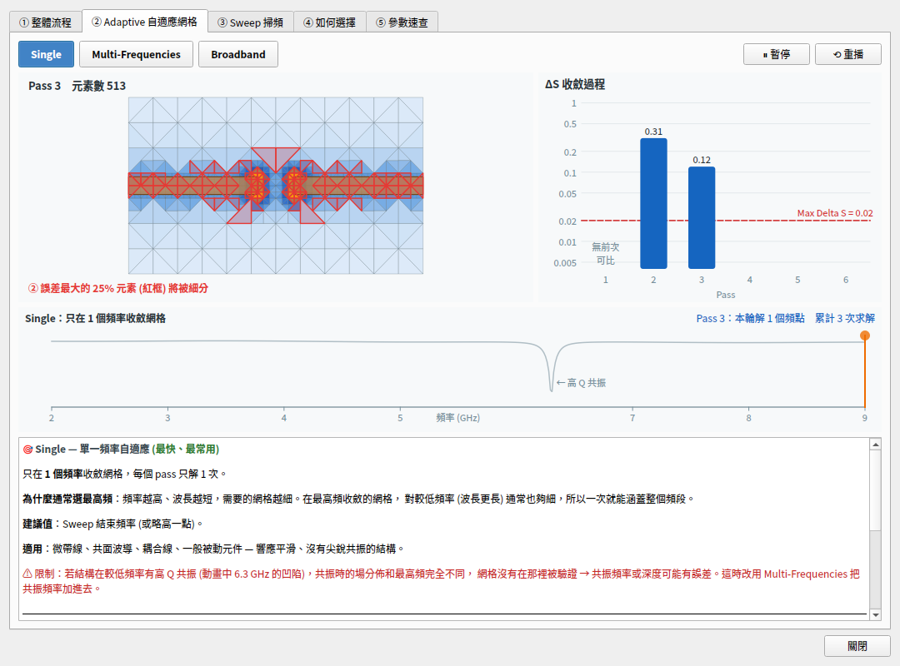
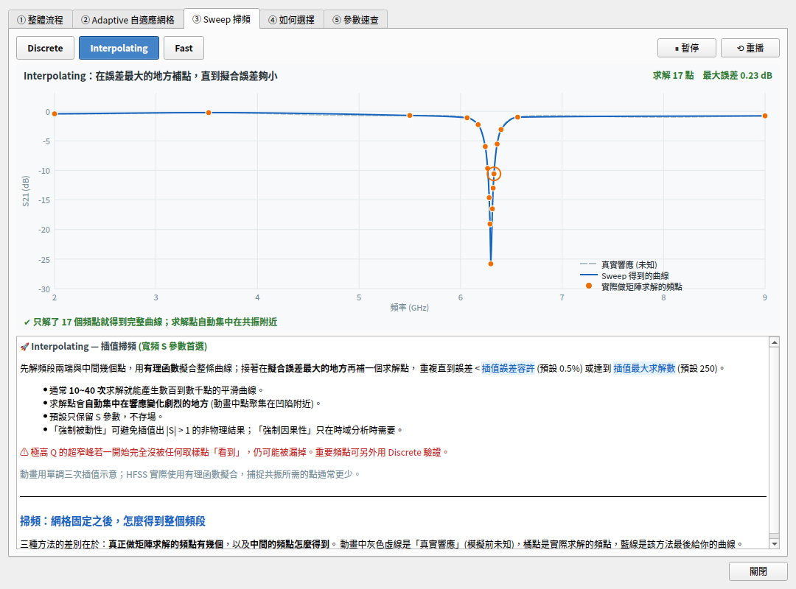

# HFSS 自動化工具

以 PyQt6 + PyAEDT 打造的 Ansys HFSS 自動化工具：從 DXF 版圖自動建立 3D 模型（MS / CPW）、設定 Wave Port 與空氣腔、執行 S 參數與場型模擬、輸出 CSV / Touchstone / 場型 GIF，並同步備份到 NAS。



- **版本**：v3.4
- **目標環境**：Windows、Ansys Electronics Desktop **2026 R1**（也可切回 2025 R2）
- **Python**：3.10 以上（建議 3.12）

---

## 目錄

- [功能](#功能)
- [安裝](#安裝)
- [快速開始](#快速開始)
- [DXF 圖層命名規範](#dxf-圖層命名規範)
- [檔案與資料夾位置](#檔案與資料夾位置)
- [求解器設定建議](#求解器設定建議)
- [YIG 磁性球](#yig-磁性球v32)
- [程式架構](#程式架構)
- [疑難排解](#疑難排解)
- [已知限制](#已知限制)
- [版本紀錄](#版本紀錄)

---

## 功能

| 類別 | 內容 |
|---|---|
| 建模 | 匯入 DXF 圖層並拉伸成 3D：微帶線 (MS)、共面波導 (CPW)、螺絲孔、金屬過孔 |
| 邊界 | 自動偵測訊號線碰到板邊的位置並建立 Wave Port（含高階模態尺寸警告）；Radiation / PML 空氣腔，Port 面 padding 自動設為 0 |
| 模擬 | Single / Multi-Frequencies / Broadband 自適應；Interpolating / Fast / Discrete 掃頻；HPC 核心、任務、GPU 分配 |
| 場型 | 沿用 S 參數的收斂網格計算指定頻率的場，不必重跑 Adaptive；自動建立 E / H 場表面圖 |
| 輸出 | S 參數 CSV（實部 / 虛部 / dB / 相位）、Touchstone `.sNp`、場型相位動畫 GIF（走 AEDT API，不靠螢幕截圖） |
| 流程 | **一鍵全流程**：建模 → S 參數 → 場型（→ GIF → 關閉備份） |
| 介面 | 任務在獨立程序中執行，求解時介面不會卡住；顯示目前步驟與經過時間；可中止任務 |
| 專案管理 | 每個專案一個資料夾；遇到同名專案時詢問要開啟舊檔或改名；自動鏡像到 NAS |
| 說明 | 內建「模式說明」視窗，用動畫解釋 Adaptive / Sweep 的運作差異，支援深色模式 |
| 繪圖 | 內建 S 參數繪圖分頁（dB / Linear / Real / Imag / Phase） |
| YIG | 在訊號線上方放置 YIG 球：自動建立 ferrite 材料、均勻偏置磁場、球體網格；計算 Kittel 頻率並加入 Adaptive，另外在共振附近細掃 |

---

## 安裝

### 1. 建立虛擬環境

```bat
python -m venv C:\LocalEnvs\HFSS_venv_2026
C:\LocalEnvs\HFSS_venv_2026\Scripts\python.exe -m pip install -r requirements.txt
C:\LocalEnvs\HFSS_venv_2026\Scripts\python.exe -m pip check
```

> AEDT 2026 R1 需要 **PyAEDT ≥ 1.5.0**。PyAEDT 1.x 的套件名稱是 `pyaedt`（匯入時的模組名稱仍為 `ansys.aedt.core`）。
> 如果環境裡裝過 `ansys-aedt-core`，建議先 `pip uninstall ansys-aedt-core`。

### 2. 指定啟動器使用的 Python（選用）

`run_HFSS自動化工具.py` 依序尋找以下 Python 直譯器：

1. 環境變數 `HFSS_VENV_PYTHON`
2. `C:\LocalEnvs\HFSS_venv\Scripts\python.exe`
3. 執行啟動器本身的 Python

```bat
setx HFSS_VENV_PYTHON C:\LocalEnvs\HFSS_venv_2026\Scripts\python.exe
```

---

## 快速開始

```bat
python main.py
:: 或雙擊 run_HFSS自動化工具.py (開啟獨立的 CMD 視窗)
```

1. 選擇 **建模方式**（MS / CPW）與 **AEDT 版本**。
2. 設定 DXF 檔、NAS 路徑、本地專案根目錄、**專案名稱**（只能使用英文、數字、`_`、`-`）。
3. 填寫板厚、材料與頻率範圍；不確定求解器怎麼選時，按 **❓ 模式說明**。
4. 按 **⚡ 一鍵全流程**，或依序按「開啟專案 → 建立 3D 模型 → S 參數模擬 → 場型模擬 → 匯出 GIF」。
5. 結果都在專案資料夾內，可用「📂 開啟資料夾」直接打開。

---

## DXF 圖層命名規範

> v3.3 起可以用內建的 **DXF 編輯器**（主控制面板 DXF 路徑旁「✏ 編輯」）直接畫：板材大小、用節點畫微波線（F1 選取、P 微波線、G 多邊形、R 矩形、C 圓；
> 雙擊線段加節點、右鍵節點刪除、Shift 鎖 0/45/90°、Alt 不吸附）。微波線的中心線存在圖層 `g_path`（HFSS 不匯入），存檔時在 `g` 產生輪廓；
> CPW 可以勾「自動產生上地」。

圖層名稱**區分大小寫**，DXF 請以 **AutoCAD 2013** 格式儲存。

### MS（微帶線）

| 圖層 | 用途 |
|---|---|
| `b` | 板材輪廓：產生底層地平面與介電層 |
| `g` | 頂層訊號走線 |
| `h` | 螺絲孔（選用）：貫穿挖空整片板子 |

### CPW（共面波導）

| 圖層 | 用途 |
|---|---|
| `db` | 下板材：產生底層地平面與介電層 |
| `ub` | 上板材：頂層地平面 |
| `g` | 頂層訊號走線 |
| `h` | 螺絲孔（選用） |
| `v` | 金屬化過孔（選用）：自動填銅，導通上下地平面 |

建模前會先檢查 DXF 圖層與材料是否存在，缺少時會直接報錯並停止。

---

## 檔案與資料夾位置

| 項目 | 位置 |
|---|---|
| 設定檔 | `%USERPROFILE%\LAB\HFSS\hfss_settings.json` |
| 本地專案 | `C:\Temp\HFSS_Local\<專案名稱>\` |
| NAS 備份 | `<NAS 路徑>\<專案名稱>\`（整個資料夾鏡像） |

本地專案資料夾內容：

```
C:\Temp\HFSS_Local\<專案名稱>\
├─ <專案名稱>.aedt
├─ <專案名稱>.aedtresults\
├─ S_para.csv          # 欄位: Frequency_GHz, Sij_real, Sij_imag, Sij_dB, Sij_phase
├─ S_para.s2p          # Touchstone (埠數依模型而定)
└─ GIF\
   ├─ E_Field_5.5GHz.gif
   └─ H_Field_5.5GHz.gif
```

- 第一次啟動時，若程式資料夾旁有舊版的 `hfss_settings.json`，會自動複製到 `LAB\HFSS`。
- 開啟專案時，若本地、NAS 或舊版位置（`<根目錄>\<名稱>.aedt`）已有同名專案，會詢問要**開啟已有檔案**還是**輸入新名稱**。NAS 或舊版位置的檔案會先複製到新的本地資料夾。

---

## 求解器設定建議

| 情境 | Adaptive | Sweep |
|---|---|---|
| 一般 MS / CPW 傳輸線 | Single @ 最高頻 | Interpolating |
| 有已知共振的濾波器、共振器 | Multi（頭、尾 + 共振頻率） | Interpolating 或 Fast |
| 高 Q、窄頻共振腔 | Single / Multi @ 共振附近 | Fast |
| 特性未知、超寬頻 | Broadband | Interpolating |
| 最終驗證關鍵頻點 | 同上 | Discrete 少數幾點 |



> 避免在寬頻 S 參數上使用「Broadband + Discrete 數百點」，這是最慢的組合。
> 詳細原理、動畫與每個參數的說明都在程式內的 **❓ 模式說明** 視窗。

「進階設定」分頁可調整：最少 Pass 數、基底函數階數、Lambda 細化、Direct / Iterative 求解器、插值誤差與最大求解數、被動性 / 因果性、Port 模態數 / 參考阻抗 / De-embed / 特性阻抗定義、Radiation / PML、無限大地平面、εr / tanδ 覆寫、GIF 解析度等。

---

## YIG 磁性球（v3.2）

在「YIG 磁性球」分頁勾選啟用後，建模時會在訊號線上方建立 YIG 球：

- **位置**：預設放在訊號線中央，可加上偏移 ΔX / ΔY；也可以改用絕對座標。球心高度會自動計算，等於走線頂面 + 間隙 + 半徑。
- **材料**：可設定 4πMs、ΔH（含量測頻率）、εr、tanδ，以 `YIG_auto` 名稱建立。指令語法取自 AEDT 2026.1 的錄製腳本。
- **偏置磁場**：可以直接輸入「外加磁場 μ0H (mT)」，程式會扣掉球體去磁場 Ms/3，換算成 HFSS 的 Bias（內部場，A/m）；也可以直接輸入 HFSS 的 Bias 值。方向可選 +Z / +X / +Y。
- **網格**：球體內設定邊長上限，並開啟曲面元素。
- **求解**：
  - 自動把 Kittel 頻率 f = (g·μB/h)·μ0H_ext 加進 Adaptive 頻點（Single 會自動改成 Multi-Frequencies）。
  - 另外在 Kittel 附近細掃，結果存成 `S_para_kittel.csv` / `.sNp`。
  - 介面會即時顯示內部場、Kittel 頻率、共振線寬，以及細掃的點間距。

> YIG 的線寬只有 MHz 等級（ΔH = 0.2 Oe ≈ 0.56 MHz），一般寬頻掃頻幾乎一定看不到共振，請以 Kittel 細掃的結果為準。

---

## 程式架構

```
main.py                     進入點 (multiprocessing.freeze_support)
ui_main.py                  PyQt6 主視窗：參數、專案管理、啟動/監看工作程序、S 參數繪圖
hfss_worker.py              HFSS 任務 (建模/模擬/匯出)，在獨立程序中執行
yig.py                      YIG 物理換算 (Kittel、內部場、線寬) 與 AEDT 指令產生
mode_help.py                模式說明視窗 (QPainter 動畫，淺色/深色主題)
config.py                   路徑、版本、Setup/Sweep 名稱、設定檔讀寫
utils.py                    頻率解析、專案路徑、NAS 備份 (robocopy)、CPU 偵測
run_HFSS自動化工具.py        在獨立 CMD 視窗啟動
plot.ipynb                  離線繪製 CSV 的 notebook
requirements.txt            鎖定版本的相依套件
```

### 為什麼 HFSS 任務要放在獨立程序

PyAEDT 呼叫 AEDT 時（特別是 `analyze_setup` 求解期間）會長時間佔住 Python 的 GIL。如果放在同一個程序的 `QThread`，介面執行緒拿不到執行權，整個視窗就會卡死。

```
┌──────────── GUI 程序 ────────────┐        ┌──────── 工作程序 (spawn) ────────┐
│ MainWindow                        │ params │ HfssWorker.run()                 │
│  ├ run_task() ────────────────────┼───────▶│  ├ PyAEDT ⇄ AEDT (gRPC)          │
│  └ QTimer 每 100 ms 讀 Queue ◀────┼────────┤  └ queue.put(('log'|'stage'|    │
│       log / stage / scale / done  │ Queue  │             'scale'|'done', …))  │
└───────────────────────────────────┘        └──────────────────────────────────┘
```

- **中止任務**：另開一個程序連線 AEDT 呼叫 `stop_simulations()`，15 秒後強制結束工作程序。
- **一鍵全流程**：所有步驟共用同一次 AEDT 連線，只在結束時備份一次。
- **場型模擬**：在 `Setup_Broadband` 上加一個單點掃頻 `Sweep_Fields`。AEDT 只會計算還沒求解的部分，已收斂的 Adaptive 與 S 參數掃頻會直接沿用。

---

## 疑難排解

| 症狀 | 處理 |
|---|---|
| 日誌出現「AEDT 2026 R1 需要 PyAEDT >= 1.5.0」 | `pip install -U "pyaedt>=1.5.0"` |
| 找不到 DXF 圖層 | 確認圖層名稱大小寫，並以 AutoCAD 2013 格式儲存 |
| 材料庫找不到材料 | 在 AEDT 2026 R1 材料庫中確認名稱，例如 `Rogers RO4003 (tm)` |
| Adaptive 一直無法收斂 | 看日誌中的「高階模態警告」，把 Port 縮放基數調到建議值 |
| GIF 沒有產生影格 | AEDT 必須以 GUI 模式執行（本工具的預設） |
| 按了中止，AEDT 仍在計算 | 自動停止是盡力而為，請在 AEDT 中手動按 Abort |
| NAS 備份失敗 | 確認 NAS 已連線且有寫入權限；robocopy 錯誤碼 ≥ 8 會顯示在日誌中 |
| 專案名稱不合法 | 只能使用英文、數字、`_`、`-`（例如舊設定中的 `testk.dxf` 需要改名） |

---

## 已知限制

- 只支援 Windows（使用 robocopy、pywin32）。
- Wave Port 自動偵測只處理板材側邊的 ±X / ±Y 平面。
- 「模式說明」的動畫是原理示意，數值不代表實際模擬結果。
- 求解中按「中止」時，停止 AEDT 模擬是盡力而為。

---

## 版本紀錄

### v3.9.2
- 修正：2D 熱圖用「參數掃描」時 AEDT 當掉（Message Manager：There is no solution setup named 'ParametricSetup_YIGMap'）。
  參數掃描改用 PyAEDT 的 parametrics API 建立，建好先確認真的在專案裡，不在就改成逐點，不再去求解不存在的 setup
- 2D 熱圖預設改成「逐點」（最穩：每點改偏置、求解、存檔，之後的點從上一點的網格繼續）；參數掃描標為實驗性
- 「讀 Simulation Monitor」：AEDT 回「can't get IGenericMonitoringMgr」（這個版本 / 模式不提供）時只提示一次，不再每 4 秒問一次

### v3.9.1
- 修正：3.9 跑模擬時 AEDT 當掉（「Please report this problem」）。3.9 把求解改成不阻塞、每幾秒讀 AEDT 的 Simulation Monitor，
  這個呼叫在求解中可能讓 AEDT 當掉 → 預設改回跟 3.8 一樣等 AEDT 算完（執行步驟清單照樣顯示步驟、耗時與預估）。
  進階設定「求解中進度」可以選「只看還在不在算」或「讀 Simulation Monitor（實驗性）」

### v3.9
- DXF 編輯器（參考 AutoCAD）：
  - 修正：滾輪縮放會跳回原位 → 現在以游標為中心縮放（放到最大也不會跳）；旁邊面板變寬變窄時畫面也不會跟著跳
  - 點節點（白色方塊）就能在左邊「選取的節點」打 X / Y，或改「距上一點」的長度與角度；◀ ▶ 換節點、方向鍵微調（Shift ×10、Alt ÷10）
  - 標註（D）：水平 / 垂直 / 對齊距離，存成 DXF 標註（圖層 dim，HFSS 不匯入）；量距離（M）：距離、ΔX、ΔY、角度；框選放大（Z）
  - 物件鎖點（F3：端點、中點、圓心、四分點、微波線輪廓角）、正交（F8）、選取時顯示每段長度與總長
  - 指令列：打座標 `x,y`、`@dx,dy`、`@長度<角度`、直接打長度；指令 L、A、REC、C、DIM、DI、M、CO、RO、MI、Z、U、OS、OR、GRID
  - 移動 / 複製到 / 旋轉 / 左右、上下鏡像 / 置中到板子
  - 「⇄ MS / CPW 自動轉換」：依板材 εr、厚度與目標阻抗（預設 50 Ω）算線寬 / 間隙（MS：Hammerstad–Jensen；CPW：接地共面波導），切換建模方式、自動上地，可以自動沿微波線加過孔
- YIG 2D 熱圖（偏置磁場 × 頻率）：YIG 分頁設偏置起點 / 終點 / 點數、頻率範圍（可自動涵蓋所有 Kittel）→「▶ 跑 2D 熱圖」
  - 參數掃描（AEDT Optimetrics，第一個偏置跑 Adaptive、其他沿用同一個網格）；做不起來自動改逐點（每點求解、每算完一點就存檔）
  - 結果存成 `*_yigmap.npz / .csv / .png`；「📈 看熱圖」：|S| dB / 線性 / 相位 / 實虛部、減背景、Kittel 線、點熱圖看 trace 與截面，逐點模擬時自動更新
- 執行進度：主控制面板多了「執行步驟」清單（連線 → 設定 → AEDT 求解 → 匯出 …），每一步的狀態、耗時、上次花多久；
  AEDT 求解改成不阻塞，每幾秒讀 AEDT 的 Simulation Monitor（Adaptive 第幾個 pass、ΔS、第幾個變數組合、百分比），進度條依各步驟預估時間前進

### v3.8
- YIG 共振對不上 Kittel 預估：實際共振會因為金屬的鏡像（球靠近訊號線 / 地平面時頻率變高）、球的尺寸（變低）、網格（偏高一點）偏離 Kittel 公式約 ±1%，
  遠大於 MHz 等級的線寬，所以 ±10 MHz 的細掃常常沒蓋到。現在 S 參數模擬做完會先從寬頻結果找實際的共振（S21 最深的 dip，沒有就看 S11），
  記錄寫出跟 Kittel 差多少；細掃沒蓋到就以實際共振為中心重掃一次（沿用同一個網格，不重跑 Adaptive）
- 記下偏移：同樣的球 / 位置 / 網格 / DXF，下次 Adaptive 頻點與細掃直接用「Kittel × 上次的比例」（YIG 分頁藍字顯示，可以取消勾選）
- 模擬做完（成功、失敗或中止）通知平台 → 手機推播（平台 1.0.25 的「🔔 通知」，每台手機自己開關）；有 YIG 時附上共振頻率
- 「❓ 參數說明」補上共振偏離 Kittel 的原因與大小估計

### v3.7.1
- 修正：AEDT 開著時無法更新 / 重新安裝。原因有兩個：① 工具跑完任務後，連著 AEDT 的背景工作程序沒有結束、占著工具的檔案；② 工具啟動的 AEDT 繼承了工具的 DLL 搜尋路徑，會載入工具資料夾裡的 DLL。現在任務結束工作程序就關掉、啟動 AEDT 時不再帶工具的 DLL 路徑、安裝程式開始前會結束殘留的工具程序（AEDT 不受影響）
- 更新前若偵測到 AEDT 占用工具的檔案（舊版工具開的 AEDT），會請你先存檔關閉 AEDT

### v3.7
- YIG 材料參數依文獻修正（Maier-Flaig et al., PRB 95, 214423 (2017) 等）：預設改成室溫單晶球 4πMs 0.180 T、Landé g 2.005、ΔH 0.27 Oe @ 9.4 GHz（α ≈ 4×10⁻⁵）；
  「材料 → 套用」可以一鍵切換「室溫 300 K」或「低溫 ≈10 K」（0.248 T、g 2.010、ΔH ≈ 0.5 Oe @ 工作頻率）
- Landé g 也寫進 HFSS 的材料（之前 HFSS 一直用預設 2.0，跟工具算 Kittel 用的 g 不一致時共振會差十幾 MHz）；AEDT 不接受時會提醒把 g 改回 2.0
- 「❓ 參數說明」新增「④ 文獻參數」：每個值的出處、異向性與其他靜磁模（Walker 模）的影響、哪些文獻參數 HFSS 不需要

### v3.6.4
- 修正：程式內更新下載完、程式關掉後沒有出現安裝進度、也沒有更新（背景的 PowerShell 沒有主控台就直接結束）。現在直接執行安裝程式（/SILENT，只有進度條），裝好由安裝程式重開；打包時會在 Windows 上實際跑一次「安裝版 → 程式內更新 → 自動重開」
- 3.6.3 以前的版本請手動執行一次 3.6.4 安裝程式，之後的更新就能在程式裡完成

### v3.6.3
- YIG 分頁「❓ 參數說明」：① 每個參數影響什麼（調大會怎樣、建議值）② 即時試算：內部場 / 是否飽和、Kittel 頻率、線寬與 Q、細掃點距（線寬內幾個點）、細掃範圍夠不夠、球體網格四面體數，附共振示意圖（含掃頻點）與「偏置 → 共振頻率」圖，可以一鍵套用回 YIG 分頁 ③ 常見問題（記憶體不夠、看不到共振、頻率偏移、掃頻失敗、Port 高階模態）

### v3.6.2
- 修正：安裝版按「立即更新」下載後程式關掉卻沒有更新（更新腳本誤等檔案總管結束，要 2 分鐘逾時才開始安裝）；現在下載完會先告訴你接下來的步驟，關閉後馬上出現安裝進度條、裝好自動重開（記錄在 %TEMP%\hfss_update.log、hfss_setup.log）
- YIG 高度：「高度：球底離波導頂面」（最低 0 = 球底貼在波導頂面）與新的「球心 Z」互相換算，低於波導頂面會標紅、不能執行

### v3.6.1
- 修正：重新建模 / 更新 YIG 時 AEDT 一直另建 `YIG_auto0`、`YIG_auto1`…（球仍用舊參數的材料）；現在已有 `YIG_auto` 就直接改它的參數
- YIG「球體網格邊長」空白 = 自動（直徑 / 8），旁邊即時估計四面體數，太細會變紅並建議數值；網格設定限制最多加 30,000 個元素，避免預先撒點就記憶體不夠
- 求解失敗時把 AEDT Message Manager 的錯誤抓到工具記錄裡；記憶體不夠時列出原因與建議（YIG 網格、Multi-Frequencies、Max Passes 等）

### v3.6
- 改成安裝程式（`HFSSTool_v3.6_windows-setup.exe`，跟量測程式、LabLogViewer 一樣）：裝在目前使用者底下（不用管理員密碼）、開始功能表與桌面捷徑、可以在「新增或移除程式」解除安裝；開啟更快（不用每次解壓）
- 程式內更新改成下載安裝程式、背景安裝（只有進度條）後自動重開；3.5 以前的單一 exe 按「立即更新」會跳出安裝畫面，裝好後舊的 exe 會自動刪掉，之後用新的捷徑
- 修正：有 YIG 時 S 參數模擬在建立掃頻就失敗（`InsertFrequencySweep`）：有 YIG 時主掃頻 Fast 自動改成 Interpolating；任何掃頻被 AEDT 拒絕都會依序改用 Interpolating → Discrete，不再整個中斷

### v3.5.1
- 修正：YIG 分頁「🧲 建立 / 更新 YIG 球」在跑完任何任務後一直是灰的（現在跟「建立 3D 模型」一起開關）
- 建模時勾著 YIG 但球沒建成 → 明確顯示 ❌ 與原因，空氣腔照常完成，修好後直接按「建立 / 更新 YIG 球」；沒勾 YIG 時記錄裡也會註明這次不建 YIG

### v3.5
- 授權伺服器查詢：站長在平台「授權」頁填好授權伺服器（例如 `1055@192.168.x.x;1055@100.x.x.x`）後，平台會輪流請開著工具的電腦用 Ansys 內附的 `lmutil lmstat -a -c` 查一次（約 30 秒一次，背景執行、不跳視窗），所以連沒裝工具的電腦在用授權也看得到，顯示 HFSS 求解、HPC 核心、占用的授權、已使用時間
- 找不到 lmutil.exe 時：在 `update.json` 填 `"lmutil": "C:\\Program Files\\ANSYS Inc\\v251\\licensingclient\\winx64\\lmutil.exe"`（或設環境變數 `HFSS_LMUTIL`）；找不到也不影響其他功能，平台會改請別台查

### v3.4
- DXF 編輯器加入曲線：微波線轉角圓角（節點表格「圓角 R」，存成 DXF 真正的圓弧）、弧線段（拖線段中點的橘色菱形、三點弧工具 A、表格「弧 °」）、Bézier 平滑曲線（曲線工具 B、曲線多邊形 K，拖藍色控制點調整）；新增「空白」範本
- YIG 分頁：「🧲 建立 / 更新 YIG 球」按鈕（不用重新建模，在現有模型上放球或換成目前參數）；3D 座標預覽（上基板表面＋波導＋YIG 球，滑鼠移到頂點顯示小球與 X/Y/Z，點一下複製座標或把球心放到那一點正上方）
- 實驗室平台「授權」頁看得到每台電腦有沒有開著 AEDT（占用 HFSS 授權）、正在跑什麼，可以標註是誰；在「版本檢查」可以填自己的名字

### v3.3
- 開啟時檢查實驗室平台有沒有新版（跟量測程式一樣）：右下角通知、狀態列「⬆ 更新到 x」，按「立即更新」自動下載、換檔、重開；之後站長一發佈就會收到推播
- DXF 編輯器（DXF 路徑旁「✏ 編輯」）：改板材大小（微波線端點跟著板邊）、用節點畫 / 改微波線（中心線＋線寬）、CPW 自動產生上地（板材 − 微波線＋間隙）、螺絲孔 / 過孔、多邊形 / 矩形、復原 / 重做；存檔前檢查圖層與 Wave Port

### v3.2
- 新增 YIG 磁性球：球體、ferrite 材料、均勻偏置磁場（外加場可自動換算成內部場）、球體網格
- Kittel 頻率自動加入 Adaptive，並在共振附近細掃（另存 `*_kittel.csv`）

### v3.1
- HFSS 任務改在獨立程序執行，求解時介面不再卡住；新增狀態列、經過時間與中止功能
- 設定檔移到 `%USERPROFILE%\LAB\HFSS`；每個專案一個資料夾，CSV / Touchstone / GIF 都放在裡面
- 同名專案檢查（開啟舊檔或改名）；NAS 改為整個資料夾鏡像
- 新增「進階設定」分頁（Adaptive、Sweep、Port、邊界、材料覆寫、GIF）
- 新增「模式說明」動畫視窗，支援淺色 / 深色模式

### v3.0
- 升級到 AEDT 2026 R1 / PyAEDT 1.x（修正 `data_real`、`close_project` 等 API 變更）
- 修正 Setup 參數鍵名（`BasisOrder`、`PercentRefinement`、`BroadBand`、`MultipleAdaptiveFreqsSetup`）；舊版的寫法可能從來沒有生效
- 場型模擬沿用 S 參數網格；新增一鍵全流程、Touchstone 輸出
- 用 AEDT API 匯出 GIF，取代螢幕截圖式 RPA（2026 R1 新版 GUI 下 RPA 會失效）
- CPU 偵測改用 psutil（Windows 11 24H2 已移除 wmic）

### v1.0
- 初版（AEDT 2025 R2）

完整變更內容見 [`readme.txt`](readme.txt)。
